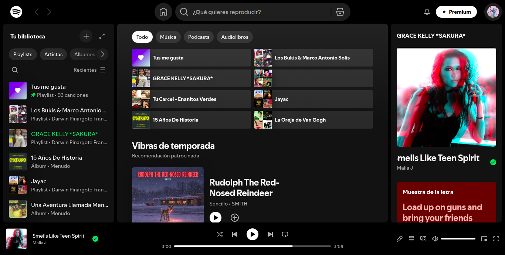

# Amphion 🎵

[-1DB954?style=for-the-badge&logo=linux&logoColor=white)](https://github.com/darwinsin822/amphion/releases/latest/download/amphion_0.6.3_amd64.deb)
[](https://github.com/darwinsin822/amphion/releases/latest)

> 🚀 **¿Quieres instalar Amphion en tu equipo?**  
> 👉 **[Descargar instalador directo (.deb v0.6.3)](https://github.com/darwinsin822/amphion/releases/latest/download/amphion_0.6.3_amd64.deb)** *(1.5 MB — compatible con Linux Mint, Ubuntu y Debian)*

---

> **Streaming puro de Spotify sobre el Web Player oficial, con interfaz Premium inyectada, para Linux Mint Cinnamon**

Amphion es un lanzador nativo en **Rust** que abre el Web Player oficial de Spotify en una ventana de aplicación y le inyecta una capa de interfaz Premium vía Chrome DevTools Protocol (CDP). No hay servidor local, no hay panel duplicado y no se almacenan credenciales.

---

## 🏛️ El Mito y la Aplicación

| 🖥️ Captura de Amphion (Linux Mint) | ⚡ Anfión: Dios y Músico de la Lira Divina |
| :---: | :---: |
|  |  |

> *En la mitología griega, **Anfión** (hijo de Zeus y Antíope) recibió de Hermes una lira de oro. Su música era tan virtuosa y celestial que las piedras y bloques de mármol cobraban vida y levitaban al son de sus melodías para edificar las monumentales murallas de Tebas. Este reproductor adopta su nombre como símbolo de armonía, agilidad y pureza acústica.*

---

## Características

* 🚀 **Un solo binario nativo:** sin Electron, sin servidor HTTP local y sin procesos auxiliares.
* 🎧 **Base 100% Spotify Web Player:** la reproducción, la biblioteca y el catálogo son los oficiales de `open.spotify.com`.
* ✨ **Capa Amphion Premium:** botón Premium, barra de acciones de reproducción y modal de ajustes de audio inyectados sobre la interfaz original.
* 🛡️ **Zero Credentials Storage:** el inicio de sesión ocurre en la página oficial de Spotify; Amphion no guarda contraseñas.
* 🔁 **Guardián CDP:** si Spotify recarga la SPA o se pierde el WebSocket, Amphion reconecta y reinyecta la interfaz automáticamente.
* 📦 **Paquete nativo `.deb`:** instalación con un clic e integración en el menú de Linux Mint.

---

## 📦 Instalación en Linux Mint / Ubuntu

### Opción 1: Descarga e Instalación Fácil (Recomendada)
1. **[Descarga aquí el paquete `amphion_0.6.3_amd64.deb`](https://github.com/darwinsin822/amphion/releases/latest/download/amphion_0.6.3_amd64.deb)**.
2. Abre tu carpeta de **Descargas**, haz doble clic sobre el archivo descargado y presiona **«Instalar paquete»** (o con clic derecho > *Abrir con Instalador de paquetes GDebi*).
3. ¡Listo! Abre **Amphion** desde el menú de inicio de tu sistema.

#### O instala en 1 comando desde la terminal:
```bash
wget https://github.com/darwinsin822/amphion/releases/latest/download/amphion_0.6.3_amd64.deb
sudo apt install ./amphion_0.6.3_amd64.deb
```

### Opción 2: compilar desde el código fuente
Requisitos: Rust (cargo) y Google Chrome.
```bash
cargo build --release
./target/release/amphion
```

Para abrir Spotify en segundo plano:
```bash
./target/release/amphion --daemon
```

---

## Licencia
MIT. Desarrollado por Darwin Pinargote Franco.
